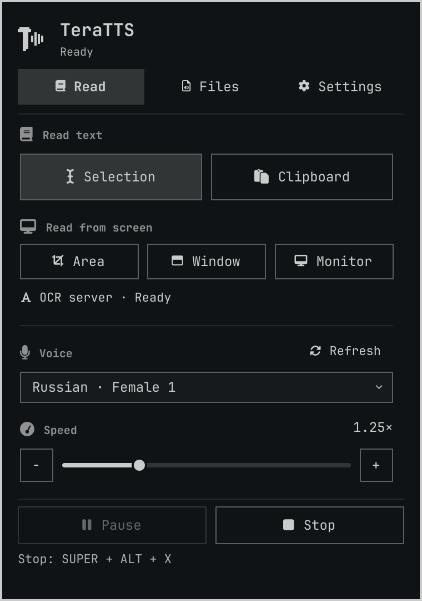
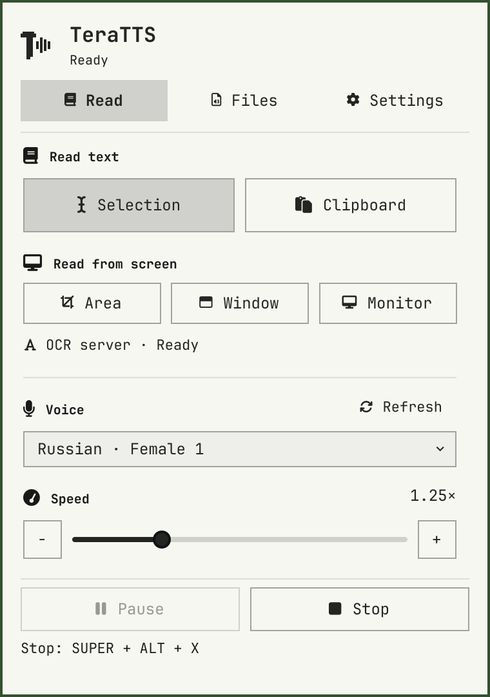
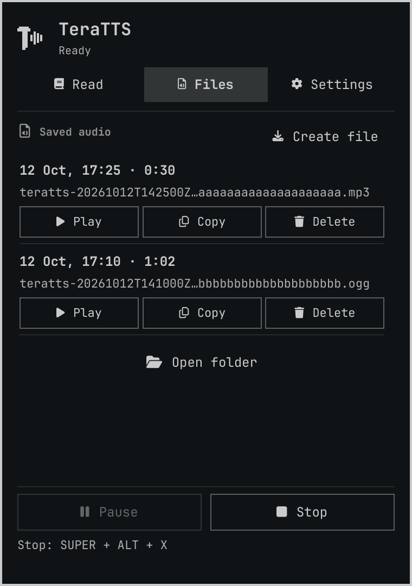
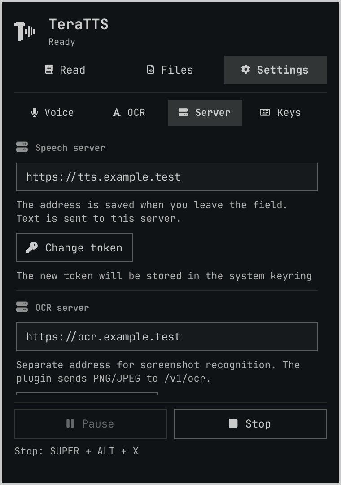

# Native previews

Captured on 14 October 2026 from this package's actual Panel.qml, TeraIcon.qml,
locale catalogs and installed Omarchy controls. Processes, surface and server
state are inert. English UI, synthetic palettes, Qt 6.12 software/offscreen.
Images are 380x540 logical units at density 2, 760x1080 pixels. They are not
production desktop captures and contain no real endpoint, account or recording.

[Download or open the 18-second silent demo](demo.mp4).

The demo uses actual QtTest pointer navigation through Read, Files, file creation,
Settings and Server. It includes labeled fixture playback and pause states; their
bands are controlled fixture inputs, not measurements of real synthesized speech.
The production player still measures its own audio. The video has 54 actual
panel frames, encoded at 3 frames per second as H.264/yuv420p, 380x540, no audio.
PNG frames and decoded video contact frames were inspected. This is a condensed
UI demonstration, not a recording of desktop interaction or a timing benchmark.

Reproduction uses tests/capture_ui.py and tests/capture_demo.py with the installed
host import tree. Explicit hashes, density, diagnostic and fixture metadata for
the distributed assets are retained in provenance.json. Local paths and raw logs
are not part of the public manifest. Renderer success does not establish every
theme/GPU/compositor, keyboard shortcut, sound quality or assistive technology.
